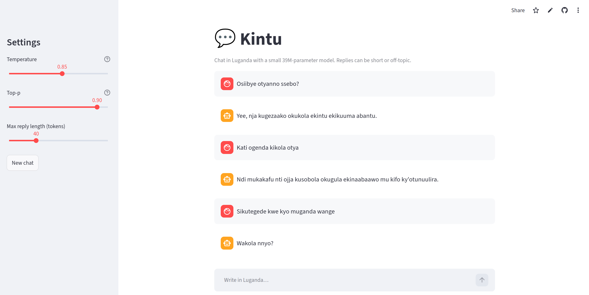

<div align=center>

# Kintu-1.0-39M 

A simple Streamlit app template for you to chat in Luganda with a small 39M-parameter model. Replies can be short or off-topic.

[](https://kintu-demo-kq5xakecfjqwi2jdxco6kq.streamlit.app/)

### Live demo

🚀[Chat with Kintu-1.0-39M](https://kintu-demo-kq5xakecfjqwi2jdxco6kq.streamlit.app/)



</div>


### How to run it on your own machine

Prerequisite: install `uv` if you don't already have it.

```
$ curl -LsSf https://astral.sh/uv/install.sh | sh
```

1. Sync the dependencies

   ```
   $ uv sync
   ```

2. Run the app

   ```
   $ uv run streamlit run streamlit_app.py
   ```
